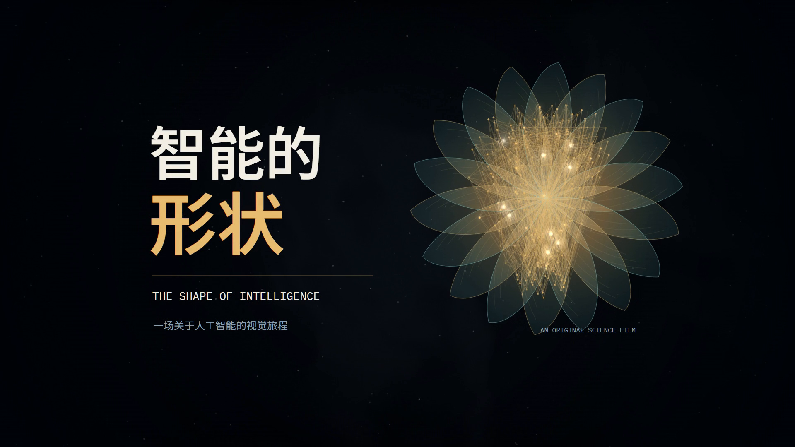

# 智能的形状 · The Shape of Intelligence

一部 4 分钟的 AI 科普短片，以原创程序动画、原创电子配乐和中英双语字幕，解释学习、表示、注意力、逐词元生成与扩散去噪。提供**中文合成旁白版**与**纯配乐版**，完整制作源码采用 MIT 许可，字体保留各自的 OFL 许可。



## 直接观看与下载

打开 [v1.0.0 发布页](https://github.com/WGcx2006/ai-shape-film/releases/tag/v1.0.0)，无需安装开发环境。

| 下载 | 内容 |
|---|---|
| [中文配音版 MP4](https://github.com/WGcx2006/ai-shape-film/releases/download/v1.0.0/ai-shape-film-narrated-1080p.mp4) | 中文合成旁白、配乐、中英双语字幕，约 96 MB |
| [纯配乐版 MP4](https://github.com/WGcx2006/ai-shape-film/releases/download/v1.0.0/ai-shape-film-music-1080p.mp4) | 原始配乐与中英双语字幕，约 96 MB |
| [单文件离线播放器](https://github.com/WGcx2006/ai-shape-film/releases/download/v1.0.0/ai-shape-film-player.html) | 纯配乐版，下载后双击 HTML 并点击播放 |
| [完整源码包](https://github.com/WGcx2006/ai-shape-film/releases/download/v1.0.0/ai-shape-film-source.zip) | 可编辑源码、字体、许可证和已生成的配乐 |
| [双语字幕 SRT](https://github.com/WGcx2006/ai-shape-film/releases/download/v1.0.0/ai-shape-film-bilingual.srt) | 31 条字幕，供再次剪辑使用 |

配音使用 `zh-CN-YunxiNeural` 合成语音，逐句按字幕时间对齐，说话时压低背景音乐。旁白制作方式和复现条件见 [配音说明](docs/配音说明.md)。

成片规格：**1920 × 1080，30 fps，240 秒，7200 帧，H.264 视频 / AAC 音频**。

- 中文配音成片：`out/智能的形状_中文配音版.mp4`
- 纯配乐成片：`out/智能的形状_AI科普短片.mp4`
- 浏览器播放器：`index.html`，通过本地服务打开。
- 单文件离线播放器：`out/智能的形状_离线播放器.html`，字体、音轨和动画全部内嵌，可直接双击打开。
- 可编辑源码包：`out/智能的形状_源码.zip`，含完整源码、字体授权与已生成的配乐。
- 双语字幕文件：`out/智能的形状_双语字幕.srt`，供再次剪辑使用；MP4 已烧录双语字幕。
- 画面总览：`out/contact-render.jpg`，运行静帧命令生成。
- 完整解码报告：`out/verification.json`，以最终 MP4 的实际解码结果为准。

## 内容与创作说明

| 时间 | 内容 |
|---|---|
| 00:00–00:24 | 从一句话到一幅画；片名 |
| 00:24–00:52 | 从样本学习，区分训练与未见数据 |
| 00:52–01:20 | 损失、梯度与参数更新 |
| 01:20–01:44 | 词元的向量表示 |
| 01:44–02:16 | 因果自注意力与上下文 |
| 02:16–02:44 | 下一个词元的概率与逐步生成 |
| 02:44–03:12 | 扩散模型与去噪过程 |
| 03:12–03:40 | 事实、来源与人的责任 |
| 03:40–04:00 | 收束与片尾 |

数学图形、粒子与动画由本工程代码生成。分类训练使用教学用合成数据；表示空间、注意力及扩散画面用于解释机制，不代表商业模型的实测结果。科学依据及具体表述边界见 [内容依据](docs/内容依据.md)。

制作方法参考了 [AnctyEnly453/abstract-algebra-promo](https://github.com/AnctyEnly453/abstract-algebra-promo) 的程序动画、音乐节奏组织及按时间逐帧导出的思路。本工程独立编写画面、字幕、配乐与导出代码，未复制参考项目的成片、音轨或源码。参考仓库的模型创作归属不作为本片的事实主张。

## 环境

- Node.js 22 或更新版本。
- Python 3.10 或更新版本，安装 `requirements.txt` 中的 NumPy。
- `package.json` 中的 Playwright 和 Sharp。
- Chrome / Edge，或 Playwright 安装的 Chromium。
- 含 `libx264` 和 AAC 支持的 FFmpeg；不需要 FFprobe。

```powershell
npm ci
python -m pip install -r requirements.txt
```

Windows 自动查找已安装的 Edge / Chrome。其他环境或未找到浏览器时，可安装 Playwright Chromium：

```powershell
npx playwright install chromium
```

FFmpeg 可以放在 `.tools/ffmpeg.exe`（其他平台为 `.tools/ffmpeg`），也可以通过 `FFMPEG_PATH` 指定或加入 `PATH`。环境路径示例：

```powershell
$env:FFMPEG_PATH = 'C:\tools\ffmpeg\bin\ffmpeg.exe'
$env:PYTHON_PATH = 'C:\Python312\python.exe'
$env:BROWSER_PATH = 'C:\Program Files\Google\Chrome\Application\chrome.exe'
```

这些变量仅在自动发现不适用时设置。`PYTHON_PATH` 用于 Node 导出脚本调用 Python；手工运行 Python 命令时，请使用安装了 NumPy 的解释器。

## 播放与导出

先生成配乐：

```powershell
python scripts/score.py
```

脚本以 NumPy 合成所有乐器、节奏与音效，经 FFmpeg 混音母带处理后，输出 `out/score.wav`（48 kHz 双声道、24 bit PCM）、`out/score.m4a`（AAC-LC、256 kbps）和 `out/audio-report.json`。没有使用外部录音或采样素材。

然后启动预览：

```powershell
npm start
```

打开 [本地播放器](http://127.0.0.1:5192)，点击播放。播放器使用本地字体和本地音频，预览与导出均不需要远程 CDN。

保留服务运行，在另一个终端检查布局、确定性随机访问并导出静帧：

```powershell
npm run check
npm run stills
```

完整成片导出：

```powershell
npm run export
```

此命令自动启动或复用本工程的预览服务，执行渲染检查，再以默认 3 个浏览器进程逐帧绘制。每 12 秒生成一个片段，共 20 个；最后拼接视频、封装配乐并完整解码验证。服务由命令启动时，会在结束后自动退出。

中断后重新运行同一命令，可复用源代码与渲染设置相同的已完成片段。源文件、字体或关键渲染设置改变后，会创建新的分片目录；不要手工混用不同版本的片段。

常用调整：

```powershell
$env:FILM_WORKERS = '2'    # 2–4，降低并发可减少内存占用
$env:FILM_CRF = '18'       # x264 质量参数，数值越低质量越高
$env:FILM_STILL_TIMES = '6,28,60,108,150,180,210,234'
npm run stills
```

`FILM_PORT` 可以修改默认端口 5192；预览服务与渲染进程须使用同一端口。`FILM_PRESET` 和 `FILM_ENCODER_THREADS` 分别控制 x264 编码速度预设与单个编码器线程数。

## 生成中文配音

完成配乐生成与纯配乐 MP4 导出后，安装可选依赖并生成旁白：

```powershell
python -m pip install -r requirements-voice.txt
python scripts/narrate.py
python scripts/verify.py out/智能的形状_中文配音版.mp4 --report out/verification-narrated.json
```

首次合成需要联网，脚本将 `src/captions.json` 中的中文发送给 Microsoft Edge 在线语音服务。之后可用缓存复用每句音频；`--offline` 禁止重新请求语音。脚本需要 `out/score.wav` 和原始 MP4，源码 ZIP 用户也应先运行 `python scripts/score.py`。输出包括中文配音 MP4、`out/narration.wav`、`out/narrated-score.m4a` 和逐句检测报告；视频流直接复制，画面不重复编码。在线语音服务可能变化，无法保证日后重新合成与本次音频逐字节一致。

## 验证范围

```powershell
python scripts/verify.py
```

`verify.py` 对最终 MP4 的视频与音频进行**全片解码**，核验 1080p、30 fps、240 秒、7200 帧、每帧连续时间戳、AAC 音轨、音频实际时长及非静音状态。还用 FFmpeg `blackdetect` 扫描全片：98% 像素低于近黑阈值、持续至少 0.5 秒的画面会被记录，只允许出现在开头或结尾各 2 秒内。

结果写入 `out/verification.json`，原始 FFmpeg 日志写入 `out/verification.ffmpeg.log`。任一必需检查失败时命令返回非零状态，不会把清单中的预期规格当作成功证据。可用位置参数检查另一个 MP4，使用 `--report` 指定报告位置。

渲染检查另外生成 `out/render-check.json`，覆盖页面报错、资源加载、绘制文本框是否越界，以及同一时间重复渲染是否一致。自动检查不评价构图美感、字形遮挡或科学叙事是否清楚；交付前仍需查看静帧并播放成片。

## 打包交付

配乐生成后，运行仅依赖 Python 标准库的打包命令：

```powershell
python scripts/package.py
```

脚本生成双语 SRT、单文件离线 HTML 和源码 ZIP。离线 HTML 内嵌动画脚本、31 条字幕、两款字体及其授权全文、项目许可证，以及 AAC 配乐；可通过 `file://` 直接打开，点击播放后开始播放音乐与画面，无需服务器或网络。此播放器播放纯配乐版；中文旁白由单独的 MP4 提供。

源码 ZIP 在 `ai-shape-film/` 目录下保留 `src/`、`scripts/`、`docs/`、`fonts/`、工程配置、本文档、项目与字体许可证及 `out/score.m4a`。它不包含 FFmpeg 二进制、依赖缓存、语音缓存、WAV 母带、MP4 或渲染分片。解压后安装环境并运行 `npm start` 即可预览；运行 `npm run export` 可重新生成纯配乐成片。修改配乐或生成旁白时先执行 `python scripts/score.py`。

打包时会检查字幕时间范围、顺序、无重叠及写入后的完整性，并读取 ZIP 内每个文件检查 CRC。结果和文件 SHA-256 保存到 `out/package-report.json`。离线播放器仍需单独进行浏览器播放检查，打包报告不会将静态资源检查写成播放验证。

## 源码地图

| 路径 | 作用 |
|---|---|
| `index.html` | 本地播放器、画布、播放与进度控制 |
| `src/film.js` | 叙事场景、时间轴、字幕与确定性逐帧绘制 |
| `src/atmosphere.js` | 背景氛围和视觉效果 |
| `src/data.js` | 可复现的分类教学训练、损失地形和梯度下降数据 |
| `src/captions.json` | 31 条中英双语字幕，使用全片绝对秒数 |
| `scripts/runtime.mjs` | 分辨率、帧率、时长、路径与依赖发现 |
| `scripts/serve.mjs` | 仅绑定本机地址的预览服务，支持音频范围请求 |
| `scripts/render.mjs` | 静帧、布局检查、逐帧分片渲染与合成 |
| `scripts/export.mjs` | 并行导出与完整验证的调度入口 |
| `scripts/score.py` | 原创配乐的程序合成、母带处理与音频检查 |
| `scripts/narrate.py` | 中文语音合成、字幕对齐、配乐避让与配音封装 |
| `scripts/verify.py` | 独立解码最终视频并输出可追溯验证结果 |
| `scripts/package.py` | 导出 SRT、内嵌全部媒体的离线 HTML 及源码 ZIP |
| `docs/内容依据.md` | 科学来源及可视化的解释边界 |
| `docs/配音说明.md` | 合成语音设置、复现条件与本次验证结果 |
| `fonts/` | 随工程提供的字体及授权文件 |

渲染接口为 `window.__render(t)`，`t` 是秒数；就绪标志是 `window.__ready`，时长由 `window.__duration` 提供。导出从 `t = 0` 到 `t = 7199 / 30`，每个时间点绘制一帧。

字体为 Noto Sans SC（文件名 `SansSC.ttf`）与 IBM Plex Mono（`Mono.ttf`），遵循各自的 SIL Open Font License；见 `fonts/NotoSansSC-OFL.txt` 和 `fonts/IBMPlexMono-OFL.txt`。分发字体时请保留授权文件。

`out/`、本地工具二进制和依赖缓存不纳入 Git。交付给观看者时提供 MP4 即可；交付可编辑工程时保留源码、字体、授权文件与内容依据，按上述流程重新生成配乐及成片。

## 许可

原创代码、文稿、字幕、程序动画与程序合成配乐采用 [MIT License](LICENSE)。字体和第三方工具保留各自的许可；具体范围见 [授权与第三方素材声明](THIRD_PARTY_NOTICES.md)。中文旁白使用第三方在线语音服务合成，语音引擎和模型不随源码分发，也不按 MIT 重新授权。
